# CLMS replica: entity-relationship model

> **What this is.** The *logical* data model of the CLMS **development replica**, derived from the code and checked against live data. It is not the production SQL Server schema: that was never available to this project, and the replica deliberately has none. Its "tables" are collections in `.local-demo/state.json`, its "foreign keys" are business codes that nothing in the storage layer enforces, and several lookup lists are constants inside the server. Use this to understand and test the replica; do not use it to design or migrate the production database.

Generated by `node scripts/erd.mjs`; `npm test` fails if it drifts (see `tests/erd.test.mjs`). Column-level detail is in [DATA-DICTIONARY.md](DATA-DICTIONARY.md).

## How to read the diagrams

- `PK` is the business key (a code, not a surrogate id, except where the collection has a counter such as `trans_id`).
- `FK` is a reference by value to another entity's key. Each line is *parent → child*; a hollow end (`|o`) means the reference may be empty.
- Entities drawn with only their key are parents shown for context. Built-in lists (legal entity, department, leave type ...) are real entities of the model but live in server code, not in the state file.
- The **Enforcement** column in the relationship table is what the API actually checks today. Most references are *not* enforced; that is the main thing a tester should know about this data.

## Overview

47 entities (11 built-in lists, 1 reserved) and 66 references. Organisation and reference data: 16; People: 2; Attendance: 12; Leave: 4; Wages and payroll inputs: 8; Users, roles and audit: 5.

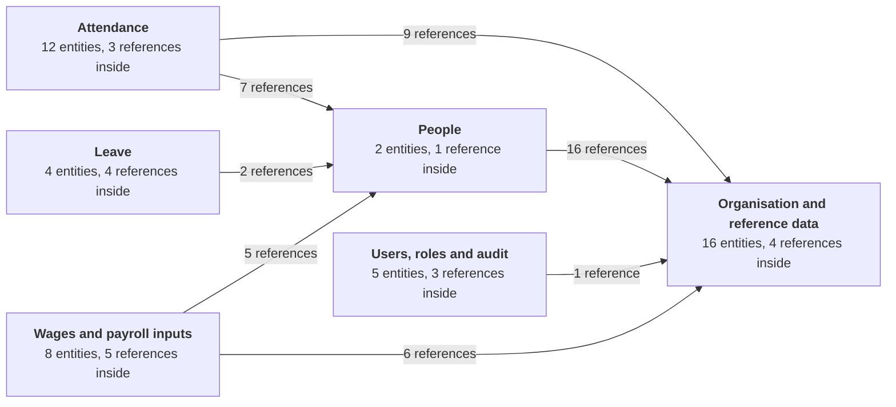

_Overview: entities grouped by domain; arrows run parent → child. Colours are not used._

## Organisation and reference data

```mermaid
erDiagram
  Bank {
    string bank_code PK
  }
  BusinessUnit {
    string bu_code PK
    string entity_code FK
  }
  City {
    string city_code PK
    string state_code PK,FK
  }
  Contractor {
    string Contractor_ID PK
  }
  CostCentre {
    string COST_CODE PK
  }
  Department {
    string dept_code PK
  }
  Designation {
    string design_code PK
  }
  Division {
    string Div_code PK
    string entity_code PK,FK
  }
  EmployeeCategory {
    string emp_category_code PK
  }
  EmployeeType {
    string emp_type_code PK
  }
  Holiday {
    string hol_date PK
    string contractor_id FK
  }
  LegalEntity {
    string entity_code PK
  }
  Location {
    string loc_code PK
  }
  Section {
    string section_code PK
  }
  State {
    string state_code PK
  }
  StatutoryState {
    string state_code PK
  }
  LegalEntity ||--o{ BusinessUnit : "entity_code"
  LegalEntity ||--o{ Division : "entity_code"
  State ||--o{ City : "state_code"
  Contractor |o--o{ Holiday : "contractor_id"
```

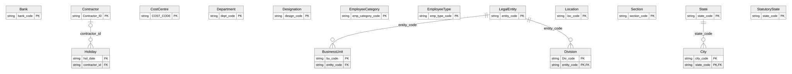

- **LegalEntity** (built into the server (not in state.json)): Built-in list (one fictional entity, E01). Not stored in state.json.
- **Department** (built into the server (not in state.json)): Built-in list (D01, D02). Not stored in state.json and not editable.
- **BusinessUnit** (`masters.business-units`): Master data > Business units.
- **Division** (`masters.divisions`): Master data > Divisions. Employees reference Div_code only.
- **Location** (`masters.locations`): Master data > Locations (also the location scope of a user).
- **CostCentre** (`masters.cost-centres`): Master data > Cost centres.
- **City** (`masters.cities`): Master data > Cities.
- **Holiday** (`masters.holidays`): Master data > Holidays; optionally limited to one contractor.
- **Contractor** (`contractors`): The labour contractors the principal employer engages.
- **State** (built into the server (not in state.json)): Built-in reference list (Indian states and union territories).
- **StatutoryState** (built into the server (not in state.json)): Built-in list of Indian states used by the compliance profiles. It is separate from State (the employee-form list, which holds one demo state), so the two never meet.
- **Designation** (built into the server (not in state.json)): Built-in reference list; service-charge rules and employees use it.
- **Section** (built into the server (not in state.json)): Built-in reference list.
- **EmployeeType** (built into the server (not in state.json)): Built-in reference list (SL, US).
- **EmployeeCategory** (built into the server (not in state.json)): Built-in reference list.
- **Bank** (built into the server (not in state.json)): Built-in reference list.

## People

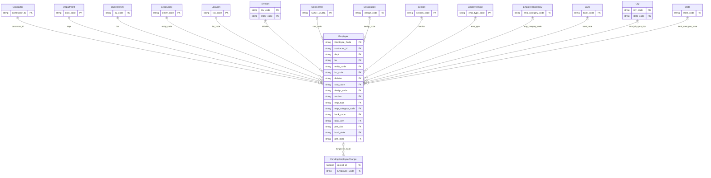

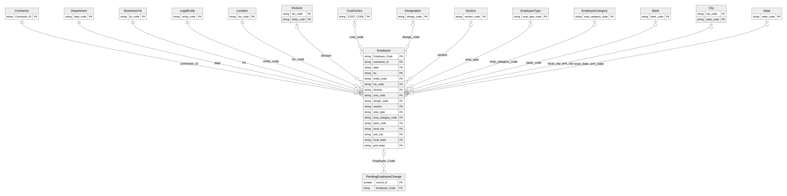

- **Employee** (`employees`): The worker master. Employee_Code is the business key every other record points at.
- **PendingEmployeeChange** (`pendingEmployees`): A new or changed worker waiting for approval. On approval the changed fields are merged into Employee.

## Attendance

```mermaid
erDiagram
  ApprovedManpower {
    string contractor_id PK,FK
    string dept_code PK,FK
    string bu_code PK,FK
    string emp_type PK,FK
  }
  AttendanceJob {
    number job_id PK
  }
  BusinessUnit {
    string bu_code PK
  }
  Contractor {
    string Contractor_ID PK
  }
  Department {
    string dept_code PK
  }
  Division {
    string Div_code PK
    string entity_code PK
  }
  Employee {
    string Employee_Code PK
  }
  EmployeeRequest {
    number request_id PK
    string employee_code FK
  }
  EmployeeType {
    string emp_type_code PK
  }
  ImportedPunch {
    string employee_code PK,FK
    string attendance_date_with_time PK
  }
  LegalEntity {
    string entity_code PK
  }
  ManualMusterEntry {
    string employee_code PK,FK
    string attendance_date PK
    string shift FK
  }
  MusterDepartment {
    string employee_code PK,FK
    string attendance_date PK
    string dept_code FK
    string bu_code FK
    string entity_code FK
    string div_code FK
  }
  ProcessedAttendance {
    string employee_code PK,FK
    string attendance_date PK
  }
  RegularisedPunch {
    string employee_code PK,FK
    string attendance_date PK
    string contractor_id FK
  }
  SandwichRule {
    number rule_id PK
  }
  Shift {
    string sh_code PK
    string sh_group FK
  }
  ShiftAllocation {
    string employee_code PK,FK
    string sh_group FK
  }
  ShiftGroup {
    string sh_group PK
  }
  ShiftGroup ||--o{ Shift : "sh_group"
  Employee ||--o{ ShiftAllocation : "employee_code"
  ShiftGroup ||--o{ ShiftAllocation : "sh_group"
  Contractor ||--o{ ApprovedManpower : "contractor_id"
  Department ||--o{ ApprovedManpower : "dept_code"
  BusinessUnit ||--o{ ApprovedManpower : "bu_code"
  EmployeeType ||--o{ ApprovedManpower : "emp_type"
  Employee ||--o{ ManualMusterEntry : "employee_code"
  Shift ||--o{ ManualMusterEntry : "shift"
  Employee ||--o{ RegularisedPunch : "employee_code"
  Contractor ||--o{ RegularisedPunch : "contractor_id"
  Employee ||--o{ MusterDepartment : "employee_code"
  Department ||--o{ MusterDepartment : "dept_code"
  BusinessUnit ||--o{ MusterDepartment : "bu_code"
  LegalEntity ||--o{ MusterDepartment : "entity_code"
  Division |o--o{ MusterDepartment : "div_code"
  Employee ||--o{ ImportedPunch : "employee_code"
  Employee ||--o{ ProcessedAttendance : "employee_code"
  Employee ||--o{ EmployeeRequest : "employee_code"
```

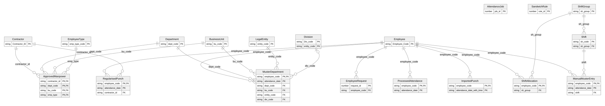

- **ShiftGroup** (`masters.shift-groups`): Master data > Shift setup.
- **Shift** (`masters.shift-times`): Master data > Shift setup. Belongs to a shift group.
- **ShiftAllocation** (`shiftAllocations`): At most one shift group (and weekly off) per worker.
- **ApprovedManpower** (`approvedManpower`): Approved headcount per contractor, department, business unit and worker type.
- **ManualMusterEntry** (`manualPunches`): A hand-entered or uploaded attendance mark. Overrides the generated muster for that worker and day.
- **RegularisedPunch** (`regularisedPunches`): A corrected IN/OUT pair; it only affects reports once approved.
- **MusterDepartment** (`musterDepartments`): Department / business-unit override for one worker-day.
- **ImportedPunch** (`importedPunches`): A raw punch uploaded from a workbook (there is no biometric feed).
- **ProcessedAttendance** (`processedAttendance`): Result of "Process attendance": first/last punch only. No payable-day rules are applied.
- **AttendanceJob** (`attendanceJobs`): Log of local attendance processing runs.
- **EmployeeRequest** (`employeeRequests`): On-duty / work-from-home request with its approval status.
- **SandwichRule** (`sandwichRules`): Draft sandwich-leave pattern. Stored only; no processing uses it.

## Leave

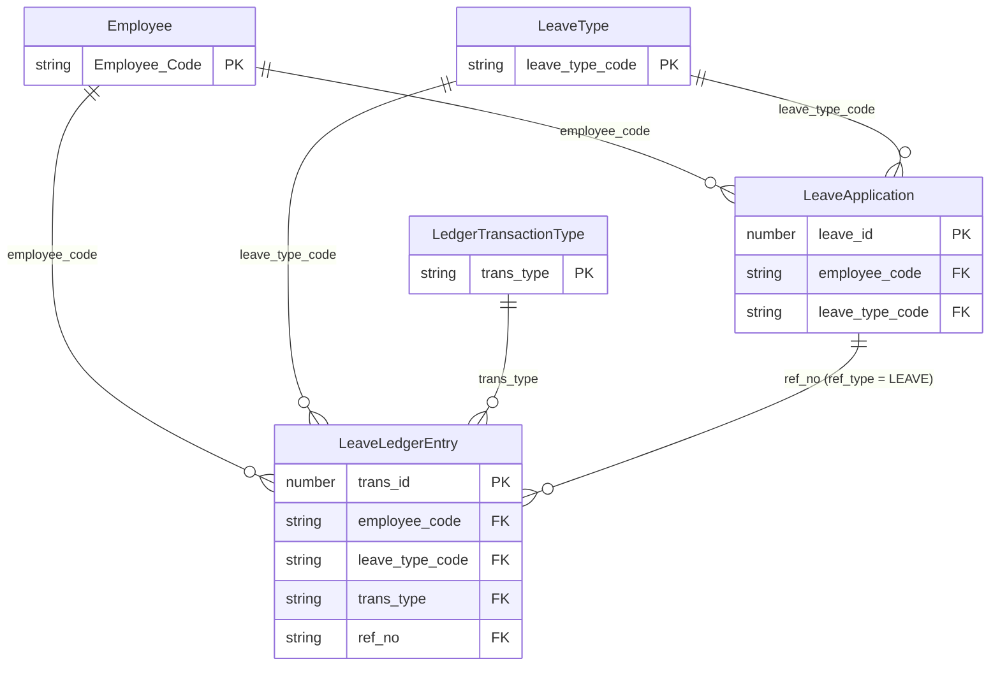

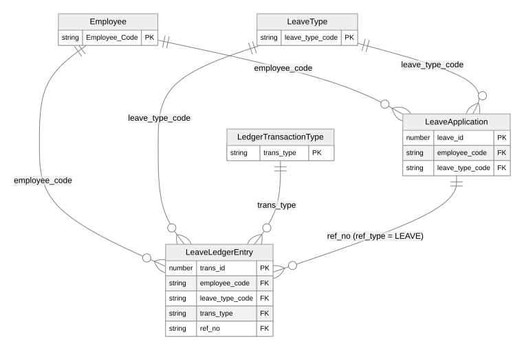

- **LeaveType** (built into the server (not in state.json)): Built-in list: CL, EL, SL.
- **LedgerTransactionType** (built into the server (not in state.json)): Built-in list; balance_effect says whether a row adds (+) or subtracts (-).
- **LeaveApplication** (`leaves`): A leave taken. Creating one also posts an AVAILED ledger row.
- **LeaveLedgerEntry** (`ledger`): The leave balance ledger: opening balances, credits, leave availed, manual adjustments.

## Wages and payroll inputs

```mermaid
erDiagram
  BusinessUnit {
    string bu_code PK
  }
  Contractor {
    string Contractor_ID PK
  }
  Designation {
    string design_code PK
  }
  Employee {
    string Employee_Code PK
  }
  FixedWage {
    string EmployeeCode PK,FK
    string BillingType PK
    string eff_date PK
  }
  LegalEntity {
    string entity_code PK
  }
  PayrollRun {
    string pmonth PK
    string billingType PK
  }
  ProcessMonth {
    string pmonth PK
    string billingType PK
  }
  ServiceChargeRule {
    number RuleID PK
    string ContractorID FK
    string entity_code FK
    string EmployeeCode FK
    string DesignCode FK
    string BuCode FK
  }
  WageArrear {
    string employee_code PK,FK
    string pmonth PK,FK
    string billingType PK,FK
    string arrearCode PK
    string arrearRefPmonth PK,FK
  }
  WageDeduction {
    string employee_code PK,FK
    string pmonth PK,FK
    string billingType PK,FK
    string dedCode PK
  }
  WageEarning {
    string employee_code PK,FK
    string pmonth PK,FK
    string billingType PK,FK
    string ernCode PK
  }
  WageProcessLock {
    string pmonth PK,FK
    string billingType PK,FK
    string entityCode PK,FK
    string ContractorId PK,FK
  }
  Employee ||--o{ FixedWage : "EmployeeCode"
  Employee ||--o{ WageEarning : "employee_code"
  ProcessMonth ||--o{ WageEarning : "pmonth + billingType"
  Employee ||--o{ WageDeduction : "employee_code"
  ProcessMonth ||--o{ WageDeduction : "pmonth + billingType"
  Employee ||--o{ WageArrear : "employee_code"
  ProcessMonth ||--o{ WageArrear : "pmonth + billingType, arrearRefPmonth + billingType"
  Contractor ||--o{ ServiceChargeRule : "ContractorID"
  LegalEntity ||--o{ ServiceChargeRule : "entity_code"
  Employee ||--o{ ServiceChargeRule : "EmployeeCode (RuleType = EmployeeCode)"
  Designation ||--o{ ServiceChargeRule : "DesignCode (RuleType = Designation)"
  BusinessUnit ||--o{ ServiceChargeRule : "BuCode (RuleType = BuCode)"
  ProcessMonth ||--o{ WageProcessLock : "pmonth + billingType"
  LegalEntity ||--o{ WageProcessLock : "entityCode"
  Contractor ||--o{ WageProcessLock : "ContractorId"
```

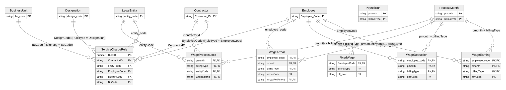

- **ProcessMonth** (`processMonths`): A wage period (monthly M or fortnightly F) with its start and end dates.
- **FixedWage** (`fixedWages`): Effective-dated wage rates of a worker. A new rate is a new row, not an edit.
- **WageEarning** (`earnings`): A recorded extra earning. An input only; nothing computes gross pay from it.
- **WageDeduction** (`deductions`): A recorded deduction. An input only.
- **WageArrear** (`arrears`): A recorded arrear for an earlier reference period. An input only.
- **ServiceChargeRule** (`serviceCharges`): A contractor service-charge rate; the rule type decides which one other column it applies to.
- **WageProcessLock** (`wageLocks`): Closes a period for a contractor (or ALL). Locked periods reject wage edits with HTTP 423.
- **PayrollRun** (never created): Reserved. No payroll engine exists, so this collection is never created; reports that read it always see nothing.

## Users, roles and audit

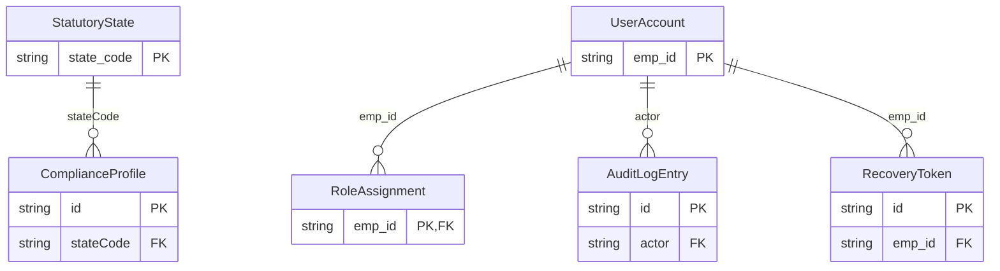

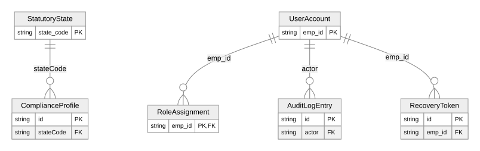

- **UserAccount** (`authUsers`): A sign-in account. Not linked to Employee: a user is not a worker.
- **RoleAssignment** (`roles`): Per user: the business units, contractors, departments, locations, menus and activities the user may use. The selections are embedded lists copied by value, so renaming a business unit or contractor does not update them, and an empty list means nothing (never everything).
- **AuditLogEntry** (`auditLog`): Who created, changed or reset which account.
- **RecoveryToken** (`recoveryOutbox`): A password-reset token held in the local outbox (nothing is e-mailed).
- **ComplianceProfile** (`complianceProfiles`): A state-wise statutory rule draft (unverified). Exactly one is active.

## Relationships and how they are enforced

| Child | Column(s) | Parent | Optional | Enforcement | Rows checked | Dangling | Note |
| --- | --- | --- | --- | --- | --- | --- | --- |
| BusinessUnit | `entity_code` | LegalEntity |  | not enforced | 2 | 0 |  |
| Division | `entity_code` | LegalEntity |  | not enforced | 1 | 0 |  |
| City | `state_code` | State |  | not enforced | 1 | 0 |  |
| Holiday | `contractor_id` | Contractor | yes | not enforced | 0 | 0 |  |
| Shift | `sh_group` | ShiftGroup |  | delete / re-key blocked | 1 | 0 | A shift group that still has shifts cannot be deleted. |
| Employee | `contractor_id` | Contractor |  | checked on create | 5 | 0 | Checked on add, pre-approve and workbook import. |
| Employee | `dept` | Department |  | checked on create | 5 | 0 |  |
| Employee | `bu` | BusinessUnit |  | checked on create; delete blocked | 5 | 0 |  |
| Employee | `entity_code` | LegalEntity |  | checked on create | 5 | 0 |  |
| Employee | `loc_code` | Location |  | delete / re-key blocked | 5 | 0 |  |
| Employee | `division` | Division | yes | delete / re-key blocked | 4 | 0 |  |
| Employee | `cost_code` | CostCentre | yes | delete / re-key blocked | 4 | 0 |  |
| Employee | `design_code` | Designation | yes | not enforced | 4 | 0 |  |
| Employee | `section` | Section | yes | not enforced | 4 | 0 |  |
| Employee | `emp_type` | EmployeeType | yes | not enforced | 5 | 0 |  |
| Employee | `emp_category_code` | EmployeeCategory | yes | not enforced | 4 | 0 |  |
| Employee | `bank_code` | Bank | yes | not enforced | 0 | 0 |  |
| Employee | `local_city` | City | yes | delete / re-key blocked | 4 | 0 |  |
| Employee | `pmt_city` | City | yes | delete / re-key blocked | 4 | 0 |  |
| Employee | `local_state` | State | yes | not enforced | 4 | 0 |  |
| Employee | `pmt_state` | State | yes | not enforced | 4 | 0 |  |
| PendingEmployeeChange | `Employee_Code` | Employee | yes | not enforced | 1 | **1** | A change points at an existing worker; a new worker has no Employee row until it is approved, so this reference is dangling by design. |
| ShiftAllocation | `employee_code` | Employee |  | checked on create | 1 | 0 |  |
| ShiftAllocation | `sh_group` | ShiftGroup |  | checked on create; delete blocked | 1 | 0 |  |
| ApprovedManpower | `contractor_id` | Contractor |  | checked on create | 2 | 0 |  |
| ApprovedManpower | `dept_code` | Department |  | checked on create | 2 | 0 |  |
| ApprovedManpower | `bu_code` | BusinessUnit |  | checked on create; delete blocked | 2 | 0 |  |
| ApprovedManpower | `emp_type` | EmployeeType |  | checked on create | 2 | 0 | The API also accepts PR, which is not in the type list. |
| ManualMusterEntry | `employee_code` | Employee |  | checked on create | 1 | 0 |  |
| ManualMusterEntry | `shift` | Shift |  | checked on create | 1 | 0 | Deleting a shift that muster rows still use is not blocked. |
| RegularisedPunch | `employee_code` | Employee |  | checked on create | 1 | 0 |  |
| RegularisedPunch | `contractor_id` | Contractor |  | checked on create | 1 | 0 | Taken from the worker; the API rejects a contractor that is not the worker's. |
| MusterDepartment | `employee_code` | Employee |  | checked on create | 1 | 0 |  |
| MusterDepartment | `dept_code` | Department |  | checked on create | 1 | 0 |  |
| MusterDepartment | `bu_code` | BusinessUnit |  | checked on create; delete blocked | 1 | 0 |  |
| MusterDepartment | `entity_code` | LegalEntity |  | checked on create | 1 | 0 |  |
| MusterDepartment | `div_code` | Division | yes | checked on create | 1 | 0 |  |
| ImportedPunch | `employee_code` | Employee |  | checked on create | 2 | 0 |  |
| ProcessedAttendance | `employee_code` | Employee |  | checked on create | 1 | 0 | Derived from imported punches, which are checked; there is no direct write path to test. |
| EmployeeRequest | `employee_code` | Employee |  | checked on create | 1 | 0 |  |
| LeaveApplication | `employee_code` | Employee |  | checked on create | 1 | 0 |  |
| LeaveApplication | `leave_type_code` | LeaveType |  | checked on create | 1 | 0 |  |
| LeaveLedgerEntry | `employee_code` | Employee |  | checked on create | 13 | 0 |  |
| LeaveLedgerEntry | `leave_type_code` | LeaveType |  | checked on create | 13 | 0 |  |
| LeaveLedgerEntry | `trans_type` | LedgerTransactionType |  | checked on create | 13 | 0 |  |
| LeaveLedgerEntry | `ref_no (ref_type = LEAVE)` | LeaveApplication |  | not enforced | 1 | 0 | Deleting a leave application deletes its ledger rows. |
| FixedWage | `EmployeeCode` | Employee |  | checked on create | 5 | 0 |  |
| WageEarning | `employee_code` | Employee |  | checked on create | 1 | 0 |  |
| WageEarning | `pmonth + billingType` | ProcessMonth |  | checked on create | 1 | 0 |  |
| WageDeduction | `employee_code` | Employee |  | checked on create | 1 | 0 |  |
| WageDeduction | `pmonth + billingType` | ProcessMonth |  | checked on create | 1 | 0 |  |
| WageArrear | `employee_code` | Employee |  | checked on create | 1 | 0 |  |
| WageArrear | `pmonth + billingType` | ProcessMonth |  | checked on create | 1 | 0 |  |
| WageArrear | `arrearRefPmonth + billingType` | ProcessMonth |  | checked on create | 1 | 0 |  |
| ServiceChargeRule | `ContractorID` | Contractor |  | checked on create | 1 | 0 |  |
| ServiceChargeRule | `entity_code` | LegalEntity |  | checked on create | 1 | 0 |  |
| ServiceChargeRule | `EmployeeCode (RuleType = EmployeeCode)` | Employee |  | checked on create | 1 | 0 |  |
| ServiceChargeRule | `DesignCode (RuleType = Designation)` | Designation |  | checked on create | 0 | 0 |  |
| ServiceChargeRule | `BuCode (RuleType = BuCode)` | BusinessUnit |  | checked on create | 0 | 0 |  |
| WageProcessLock | `pmonth + billingType` | ProcessMonth |  | checked on create | 1 | 0 |  |
| WageProcessLock | `entityCode` | LegalEntity |  | checked on create | 1 | 0 |  |
| WageProcessLock | `ContractorId` | Contractor |  | checked on create | 1 | 0 |  |
| RoleAssignment | `emp_id` | UserAccount |  | checked on create | 1 | 0 | Roles can only be saved for an existing account; deactivating or renaming the account does not touch them. |
| AuditLogEntry | `actor` | UserAccount |  | not enforced | 2 | 0 |  |
| RecoveryToken | `emp_id` | UserAccount |  | checked on create | 1 | 0 | A reset request for an unknown ID answers success but stores no token (it does not reveal which IDs exist). |
| ComplianceProfile | `stateCode` | StatutoryState |  | not enforced | 2 | 0 |  |

Of 66 references: 41 checked on create, 4 checked on create and protected on delete, 6 protected on delete only, **15 not enforced at all**.

## Integrity of the sample data

Every reference above was checked against the seed plus the scenario state (161 values). Dangling: PendingEmployeeChange.Employee_Code → Employee (Employee_Code="DEMO006").

## Things the model does not express

- **Dates** are stored as text in two shapes: `YYYY-MM-DD` and full ISO date-times (`2026-09-01T00:00:00.000Z`). Seeded process months use the long form; months added through the API use the short form. Comparisons in the server normalise to the first 10 characters; an exporter or test that compares raw strings must do the same.
- **Duplicate spellings.** Several records carry the same value under two names (`Employee_Code` and `employee_code`, `billingType` and `billingtype`, `dept` and `dept_code`). Both are written by the server; read either, write through the API.
- **Case.** Business keys are case-sensitive text (`D001` is not `d001`). Numeric spreadsheet cells are converted to text on write.
- **Leave across months.** A leave application spanning two months posts all its days to the first month in the ledger.
- **Deleting.** Contractors and workers cannot be deleted through the API (a worker is made inactive; an inactive worker keeps all history). Master rows that are still referenced cannot be deleted or re-keyed (HTTP 409). A process month that has earnings, deductions or arrears cannot be deleted (409). Deleting a leave application also deletes its ledger rows. Every other delete (approved manpower, sandwich rules, service-charge rules, wage locks, muster and regularisation rows, wage inputs) removes the row alone, because nothing depends on it.
